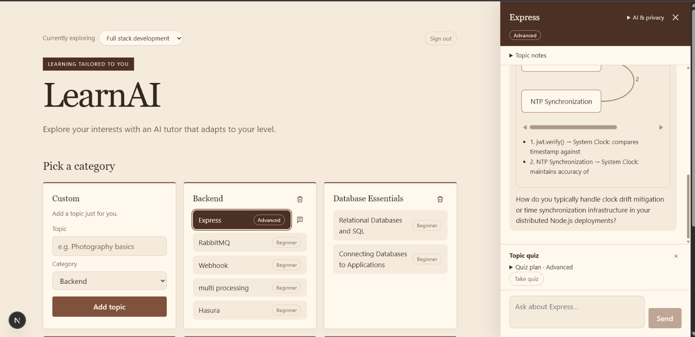
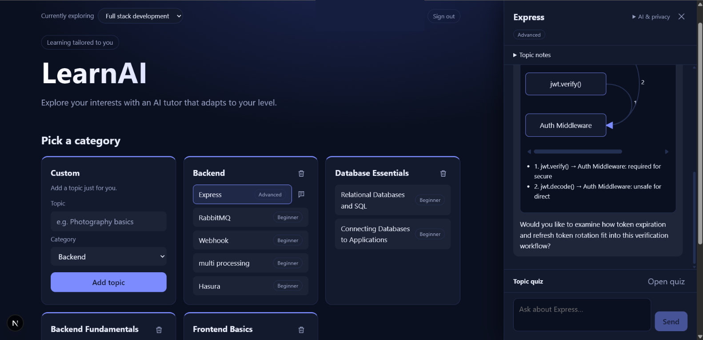
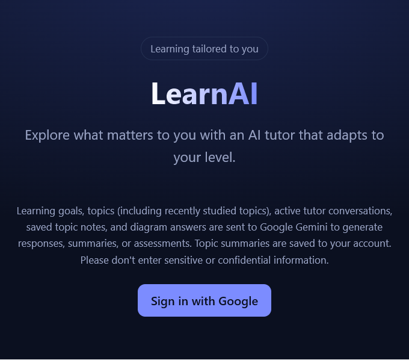

# LearnAI

<p align="center">
  <strong>Learn what matters to you. Pick up where you left off.</strong>
  <br />
  A personal AI learning companion for curious minds, career pivots, and real-world questions.
</p>

<p align="center">
  <a href="https://github.com/Abhi-MS/LearnAI/actions/workflows/ci.yml"></a>
</p>

LearnAI is built around a simple idea: **learning should follow your curiosity, not force you through someone else's course.** Tell it what you want to understand, explore the topics that matter to you, and have a tutor meet you at your level. Come back later and continue from a concise note of what you already covered.

There are no required lesson lengths or streaks. And a good-sounding conversation is not treated as proof that you learned something: progress comes from validated quiz results.

**[Try the live demo](https://learn-ai-silk.vercel.app/)** — select **Sign in with Google** to use your Google account.



The screenshot shows the updated theme; the live demo may look different until it is deployed.

<details>
<summary>Earlier demo screenshots</summary>





</details>

## The learning loop

1. **Choose your direction.** Describe an industry, skill, or subject. LearnAI creates a starting plan, and you can change it, add topics, or keep separate explorations.
2. **Follow the question.** Open a topic for an explanation, then ask what you actually want to know. The tutor uses examples and analogies, draws a diagram when it helps, and invites you to keep exploring.
3. **Pick up where you left off.** When you finish, LearnAI can save a short topic note with the key ideas and a suggested next step—not your full conversation.
4. **Check what stuck.** Take an optional five-question quiz. Two independent grading checks validate the result; a passing score moves your topic forward.

## What makes it different

- **Your path, not a prescribed syllabus.** Start with an AI-generated plan, then add your own topics and follow your interests.
- **Flexible by design.** Explore in short sessions or go deeper; there is no timer or required sequence.
- **A tutor, not a talking search box.** Learn through explanations and dialogue, with diagrams used selectively and learning checks offered when useful.
- **Progress with evidence.** Topic levels are based on validated quiz outcomes, not time spent, chat activity, or AI guesses about mastery.
- **Continuity without chat hoarding.** A rolling note helps you resume while the full tutor conversation is discarded when the session ends.

## Project status

The core learning loop is implemented: sign-in, personal learning plans, topic management, tutoring, resumable topic notes, quizzes, and evidence-based progress. A demo is available on Vercel; formal evaluation and Azure deployment are still planned. See the [product blueprint](BLUEPRINT.md) for the principles behind the project and what is next.

## Run locally

### You will need

- Node.js 20 or later
- A Supabase project with Google sign-in configured
- A Google Gemini API key

### Setup

1. Install packages and create your local environment file:

   ```sh
   npm install
   cp .env.example .env.local
   ```

   On PowerShell, use `Copy-Item .env.example .env.local` instead of `cp`.

2. In `.env.local`, configure `DATABASE_URL`, `NEXT_PUBLIC_SUPABASE_URL`, `NEXT_PUBLIC_SUPABASE_ANON_KEY`, and `GEMINI_API_KEY`. The other settings are optional; see [`.env.example`](.env.example).
3. Apply the SQL files in [`db/migrations`](db/migrations) in numeric order (`001` through `009`) to your Supabase database. Migrations `003` through `009` build on the earlier schema and Supabase Auth.
4. Configure Google sign-in in Supabase and add `http://localhost:3000/auth/callback` to Supabase's allowed redirect URLs.
5. Start the app:

   ```sh
   npm run dev
   ```

   Open [http://localhost:3000](http://localhost:3000). Check the database connection at `/api/health/db`.

### Checks

```sh
npm run lint
npm run test -- --run
npm run build
```

CI runs lint and tests on pushes to `main`/`master` and on pull requests.

## Privacy and AI limitations

LearnAI sends learning goals, topic names, active tutor context, quiz content, and topic notes to Google Gemini to generate plans, explanations, summaries, and assessments. For some recall checkpoints, it may also send up to 50 recently studied topic names. Supabase stores your account's learning plan, topic progress, quiz plans and results, concept gaps, and one rolling note per topic. Full tutor conversations are not retained as chat history; submitted quiz answers are not stored as answers, though scores and feedback are.

Do not submit sensitive or confidential information. Gemini responses, generated quizzes, and grading can be inaccurate or outdated; verify important claims with reliable, current sources. Review Google's and Supabase's data-handling terms before using the app with real learner data.

The optional Sentry integration sends reduced generic error events; performance tracing is disabled. Supabase database connections verify TLS certificates and hostnames. If your database requires a custom CA, set `SUPABASE_DB_CA_CERT` as described in [`.env.example`](.env.example)—do not disable certificate verification.

## Read-only MCP server

Run `npm run mcp` to start the stdio MCP server. It exposes `list_tracks` and `list_topics` against the app's Postgres database; calls are rate-limited with `MCP_DAILY_CALL_LIMIT` (default `500`), and each topic listing is capped at 25 results.

## Documentation

- [Product blueprint](BLUEPRINT.md) — product concept, principles, shipped capabilities, and roadmap.
- [Database notes](db/README.md) — schema overview and migration guidance.
